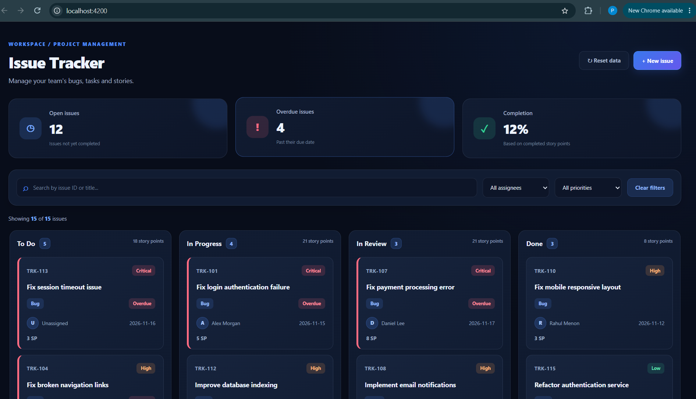
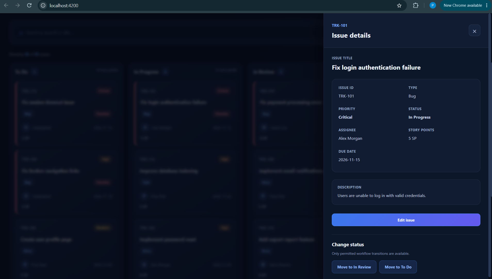
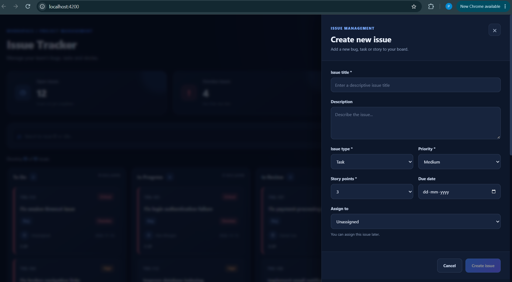
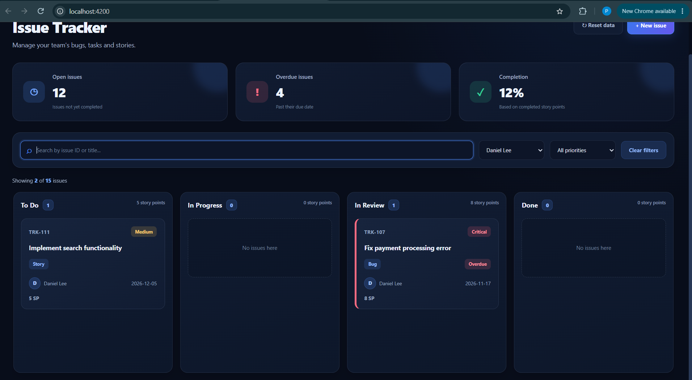
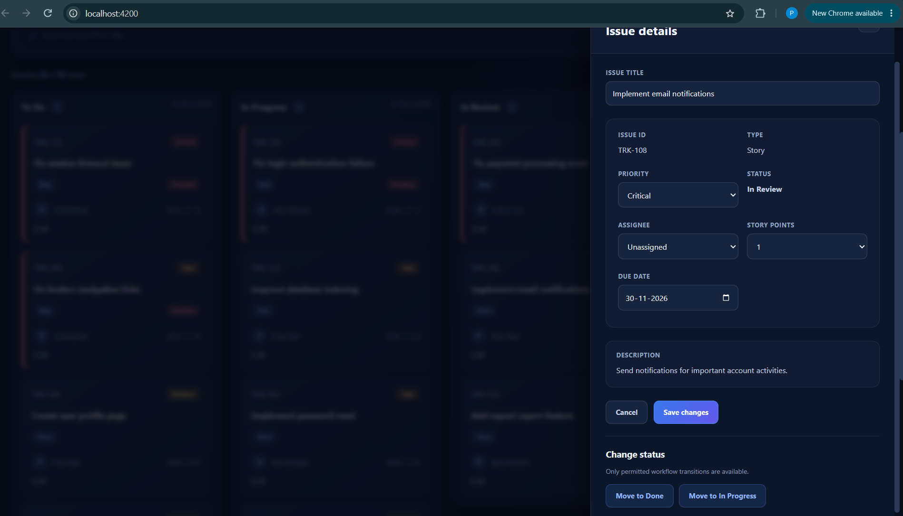

# Angular Signals Issue Tracker

A modern, responsive Issue Tracking application built using **Angular 22** and **Angular Signals**. The application provides a Kanban-style board for managing bugs, tasks, and stories through a structured workflow.

## Project Overview

The Issue Tracker helps teams organize, assign, prioritize, and track issues across four workflow stages:

- To Do
- In Progress
- In Review
- Done

It includes real-time filtering, issue management, workflow validation, dashboard statistics, and persistent local data storage.


## Application Screenshots

### 1. Dashboard
Displays the Kanban board with issue columns and dashboard statistics.



### 2. Issue Details
Displays the selected issue's complete information.



### 3. Create Issue
Displays the form for creating a new issue.



### 4. Search and Filters
Displays the issue search and filtering functionality.



### 5. Edit Issue
Displays the issue editing interface.




## Features

### 1. Kanban Board
- Four workflow columns.
- Issue count and total story points for each column.
- Issue cards displaying ID, title, type, priority, assignee, due date, and story points.
- Issues sorted by priority and due date.
- Visual indicators for overdue issues.

### 2. Issue Management
- Create new issues.
- View complete issue details.
- Edit issue title, priority, assignee, story points, and due date.
- Save or cancel changes.
- Automatically generate sequential issue IDs.
- Support for Bug, Task, and Story issue types.

### 3. Search and Filtering
- Search issues by title or issue ID.
- Filter by assignee.
- Filter by priority.
- Combine multiple filters.
- Clear filters to restore the complete issue list.
- Display the number of filtered issues.

### 4. Dashboard Statistics
- Total open issues.
- Number of overdue issues.
- Completion percentage based on story points.

### 5. Workflow and Business Rules
- Validate allowed status transitions.
- Require an assignee before moving an issue to In Progress.
- Limit each team member to a maximum of three In Progress issues.
- Prevent issues from being unassigned while In Progress.
- Validate story points (1, 2, 3, 5, or 8).
- Require a due date before moving an issue to In Progress.
- Clear the due date when reopening a Done issue.
- Identify overdue issues based on their due dates.

### 6. Data Persistence
- Load initial issue and team data from JSON files.
- Persist changes using browser localStorage.
- Preserve changes after refreshing the browser.
- Restore original seed data using the Reset Data option.
- Include loading and error handling states.

## Technologies Used

| Technology | Purpose |
|---|---|
| Angular 22 | Frontend framework |
| TypeScript | Application logic |
| Angular Signals | Reactive state management |
| signal() | Writable reactive state |
| computed() | Derived reactive values |
| linkedSignal() | Dependent editable state |
| resource() | Asynchronous data loading |
| effect() | Data persistence |
| HTML5 | Application structure |
| CSS3 | Styling and responsive layout |
| JSON | Initial issue and team data |
| localStorage | Browser-based data persistence |
| Git and GitHub | Version control and source code hosting |

## Project Structure

```text
issue-tracker/
│
├── public/
│   ├── issues.json
│   └── team.json
│
├── src/
│   ├── app/
│   │   ├── core/
│   │   │   ├── models/
│   │   │   │   └── issue.model.ts
│   │   │   └── services/
│   │   │       └── issue-store.ts
│   │   │
│   │   ├── features/
│   │   │   └── issues/
│   │   │       ├── components/
│   │   │       │   ├── issue-card/
│   │   │       │   ├── issue-detail-panel/
│   │   │       │   ├── issue-form/
│   │   │       │   └── kanban-column/
│   │   │       │
│   │   │       └── pages/
│   │   │           └── board/
│   │   │
│   │   ├── app.config.ts
│   │   ├── app.html
│   │   └── app.ts
│   │
│   └── styles.css
│
├── angular.json
├── package.json
└── README.md
```

## Installation and Setup

### Prerequisites

Make sure the following are installed:

- Node.js
- npm
- Angular CLI 22
- Visual Studio Code (recommended)

### 1. Clone the repository

```bash
git clone https://github.com/Parvathyrprasad/angular-signals-issue-tracker.git
```

### 2. Navigate to the project directory

```bash
cd angular-signals-issue-tracker
```

### 3. Install dependencies

```bash
npm install
```

### 4. Start the development server

```bash
ng serve
```

### 5. Open the application

Navigate to:

http://localhost:4200/

The application automatically reloads whenever source files are modified.

## Build

To create a production build, run:

```bash
ng build
```

The generated production files are stored in the `dist/` directory.

## Testing

To execute the project's unit tests, run:

```bash
ng test
```

## Initial Data

The application loads its initial data from:

- `public/issues.json` – Contains the initial issue records.
- `public/team.json` – Contains team member information.

Changes made within the application are stored in browser localStorage and persist across page refreshes.

Use the **Reset Data** option to restore the original seed data.

## GitHub Repository

Source code:

https://github.com/Parvathyrprasad/angular-signals-issue-tracker

## Author

**Parvathy R Prasad**

Angular Signals Issue Tracker – 2026
